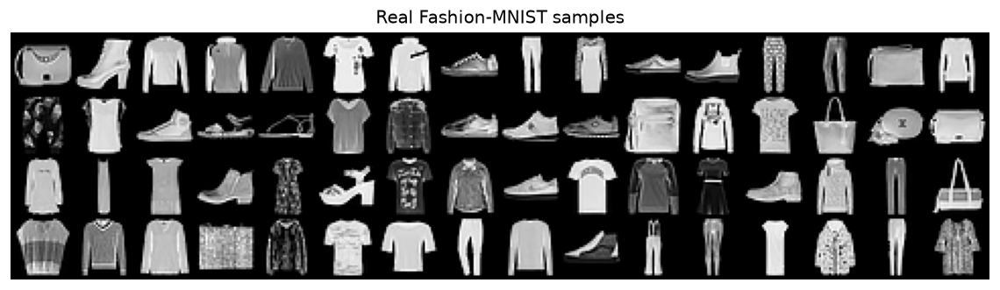
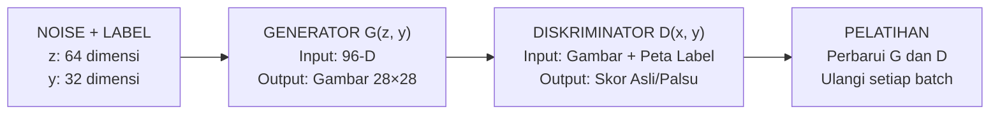
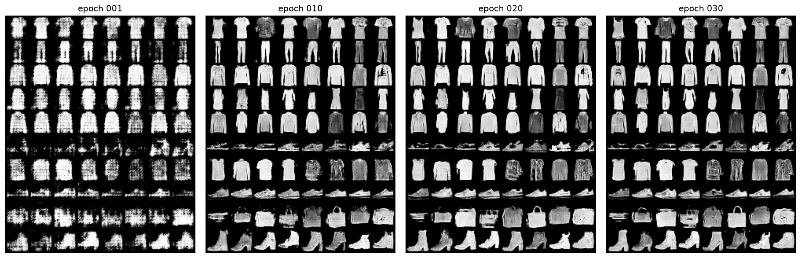
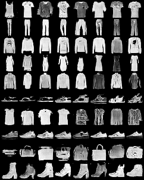
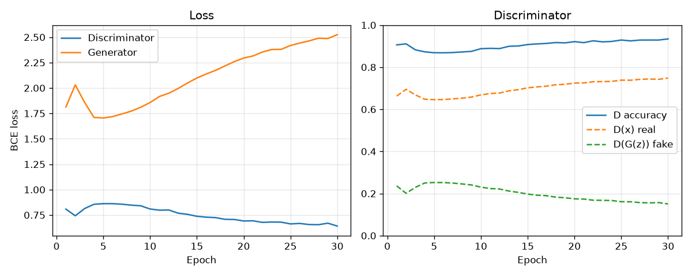
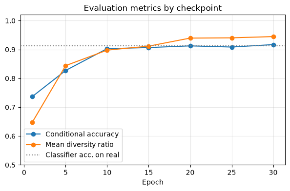
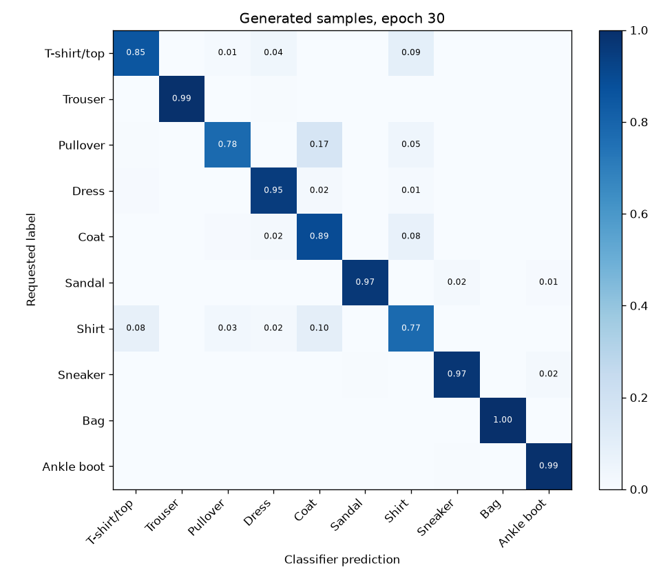

# Laporan Akhir Proyek 1 — Conditional GAN untuk Fashion-MNIST

<div align="center">

**A DAY IN ALI / AI GENERATIF**  
**Mata Kuliah:** CAK4KBB3 — *Vibe Coding Generative AI from Scratch*  
**Kelompok:** A Day in Ali • Telkom University  

[](#2-dataset-fashion-mnist)
[](#4-implementasi--konfigurasi-pelatihan)
[-4A5568?style=for-the-badge)](#3-model-bagaimana-cgan-bekerja)
[](#5-luaran--hasil-evaluasi)

</div>

---

## Daftar Isi

1. [Masalah & Metode yang Dipakai (Conditional GAN)](#1-masalah--metode-yang-dipakai-conditional-gan)
2. [Dataset: Fashion-MNIST](#2-dataset-fashion-mnist)
3. [Model: Bagaimana cGAN Bekerja & Alur Data](#3-model-bagaimana-cgan-bekerja--alur-data)
4. [Implementasi & Konfigurasi Pelatihan](#4-implementasi--konfigurasi-pelatihan)
5. [Luaran & Hasil Evaluasi](#5-luaran--hasil-evaluasi)
6. [Penggunaan AI (LLM) & Studi Kasus Debugging](#6-penggunaan-ai-llm--studi-kasus-debugging)
7. [Manajemen Proyek & Pembagian Peran Anggota](#7-manajemen-proyek--pembagian-peran-anggota)
8. [Keterbatasan, Pelajaran, & Rencana Lanjutan](#8-keterbatasan-pelajaran--rencana-lanjutan)

---

## 1. Masalah & Metode yang Dipakai (Conditional GAN)

**Tujuan:** Menghasilkan gambar pakaian berukuran $28 \times 28$ piksel yang mudah dikenali, sesuai dengan kategori yang dipilih pengguna, dan tetap bervariasi — dibangun dari nol (*from scratch*) menggunakan metode *Vibe Coding*.

### Mengapa Conditional GAN (cGAN)?
GAN biasa menghasilkan gambar secara acak tanpa bisa ditentukan jenis objeknya. Dengan **Conditional GAN (cGAN)**, kami menambahkan informasi **label kategori pakaian** pada kedua jaringan sehingga pengguna dapat menentukan kategori gambar yang ingin dibuat:

| Perbandingan | GAN Biasa | Conditional GAN (cGAN) Kami |
| :--- | :--- | :--- |
| **Masukan (*Input*)** | *Noise* acak | *Noise* acak + **label pakaian** (`0–9`) |
| **Keluaran (*Output*)** | Gambar benda acak | Gambar **sesuai label yang dipilih** |
| **Kendali Pengguna** | Tidak dapat menentukan apakah hasilnya baju, sepatu, atau tas | Contoh: pilih **“Sneaker”** → model membuat gambar sepatu berukuran $28 \times 28$ |

---

## 2. Dataset: Fashion-MNIST

Dataset sederhana dan konsisten dari Zalando Research memudahkan pengujian cGAN berukuran kecil tanpa memerlukan perangkat keras berat:

| Properti Dataset | Nilai / Keterangan |
| :--- | :--- |
| **Gambar Latih (*Training*)** | `60.000` gambar (6.000 per kategori) |
| **Gambar Uji (*Testing*)** | `10.000` gambar (1.000 per kategori) |
| **Ukuran & Format** | $28 \times 28$ piksel, *grayscale* (1 kanal) |
| **Sepuluh Kategori Pakaian** | `0` Kaos (*T-shirt/top*) · `1` Celana panjang (*Trouser*) · `2` *Pullover* · `3` Gaun (*Dress*) · `4` Mantel (*Coat*) · `5` Sandal · `6` Kemeja (*Shirt*) · `7` *Sneaker* · `8` Tas (*Bag*) · `9` Sepatu bot (*Ankle boot*) |
| **Persiapan Data** | Nilai piksel dinormalisasi ke rentang `[-1, 1]` agar sesuai dengan keluaran `Tanh` pada generator. *Noise* dan label tetap (*fixed grid*) digunakan ulang agar hasil antarepoch dapat dibandingkan secara langsung. |


*Gambar 1: Sampel asli dari dataset Fashion-MNIST pada ke-10 kategori pakaian.*

---

## 3. Model: Bagaimana cGAN Bekerja & Alur Data

Dua jaringan dilatih secara bersaing, dan keduanya sama-sama menerima informasi label kelas:



- **Generator $G(z, y)$ (`741.249` parameter):** Menggabungkan *noise* 64 dimensi + *embedding* label 32 dimensi menjadi masukan 96 dimensi → proyeksi linear → diperbesar bertahap dari $7 \times 7$ ke $14 \times 14$ lalu $28 \times 28$ → menghasilkan gambar lewat aktivasi `Tanh`.
- **Diskriminator $D(x, y)$ (`192.881` parameter):** Menerima gambar $28 \times 28$ dan peta spasial label kelas ($28 \times 28$). Tiga lapisan konvolusi menghasilkan satu *logit* asli/palsu untuk menilai apakah gambar tersebut nyata sekaligus cocok dengan label kelasnya.
- **Total Parameter (`934.130` / ~0,93M parameter):** Intinya, Generator ($G$) berusaha mengecoh Diskriminator ($D$), sedangkan $D$ belajar membedakan gambar asli dan buatan. Ukuran ~0,93M menjaga pelatihan tetap ringan di CPU maupun GPU.

---

## 4. Implementasi & Konfigurasi Pelatihan

Model dirancang sebagai sistem dasar yang ringan, modular, dan dapat direproduksi sepenuhnya (*reproducible*), bukan mengandalkan model besar yang sudah dilatih sebelumnya (*pretrained*).

### Konfigurasi & Pelatihan Adversarial
| Parameter Konfigurasi | Pengaturan | Strategi Pelatihan Adversarial |
| :--- | :--- | :--- |
| **Jumlah Epoch** | `30` Epoch | **Fungsi Loss:** `BCEWithLogitsLoss` untuk kedua jaringan |
| **Ukuran Batch** | `128` | **Label Smoothing (Asli):** `0,9` (satu sisi, agar $D$ tidak terlalu dominan) |
| **Learning Rate Adam** | `0,0002` (`2e-4`) | **Siklus Update:** Setiap batch memperbarui $D$ satu kali dan $G$ satu kali |
| **Beta Adam** | `(0,5; 0,999)` | **Penyimpanan Otomatis:** *Checkpoint* (`ckpt.pt`), riwayat loss (`history.json`), dan grid sampel berlabel tetap disimpan setiap berkala |
| **Random Seed** | `42` | **Fitur Resume:** Pelatihan yang terhenti dapat dilanjutkan kembali dari *checkpoint* terakhir |

### Struktur Modul Kode & Pengujian (`src/` & `tests/`)
- [`src/config.py`](../src/config.py) & [`src/utils.py`](../src/utils.py) — Hyperparameter terpusat, *seeding* deterministik, manajemen *checkpoint* aman (`weights_only=True`), dan penyalinan gambar laporan.
- [`src/data.py`](../src/data.py) — *DataLoader* Fashion-MNIST dengan normalisasi `[-1, 1]` dan pembuat *fixed noise/label grid*.
- [`src/models.py`](../src/models.py) — Arsitektur `Generator` dan `Discriminator` beserta perhitungan parameter.
- [`src/train.py`](../src/train.py) & [`src/plots.py`](../src/plots.py) — Perulangan pelatihan adversarial, penyimpanan *checkpoint*, dan pembuatan grafik kurva loss.
- [`src/sample.py`](../src/sample.py) & [`src/evaluate.py`](../src/evaluate.py) — Pembuatan grid gambar dari *checkpoint* serta evaluasi kuantitatif menggunakan CNN terpisah.
- [`tests/`](../tests) — **14 unit test otomatis** (`test_data.py`, `test_models.py`, `test_train.py`, `test_sample_evaluate.py`) yang seluruhnya lulus (`14/14 OK`).

---

## 5. Luaran & Hasil Evaluasi

### A. Bagaimana Hasil Gambar Dievaluasi?
Selain pemeriksaan visual, sebuah **Classifier CNN terpisah** dilatih pada data asli Fashion-MNIST untuk menghitung tiga metrik evaluasi secara objektif terhadap 10.000 gambar buatan generator (1.000 gambar per kelas):
1. **Akurasi Kondisional (*Conditional Accuracy*):** Seberapa sering classifier memprediksi kelas yang sesuai dengan label yang diminta pada generator? Semakin tinggi, semakin baik kesesuaian kelas yang terukur.
2. **Entropi Prediksi (*Prediction Entropy*):** Apakah prediksi tersebar merata di sepuluh kategori, bukan terkumpul pada satu kelas saja? Nilai mendekati `1,0` berarti distribusi prediksi seimbang.
3. **Rasio Keberagaman (*Diversity Ratio*):** Membandingkan jarak rata-rata antarfitur gambar buatan dan gambar asli di dalam ruang fitur CNN 128 dimensi. Nilai mendekati `1,0` berarti tingkat variasi gambar buatan serupa dengan data asli.

### B. Hasil Evaluasi Akhir (Pelatihan 30 Epoch — CUDA)

| Metrik Evaluasi | Nilai Capaian | Interpretasi |
| :--- | ---: | :--- |
| **Akurasi Kondisional (Gambar Buatan)** | **`91,70%`** | Kesesuaian label gambar buatan menurut CNN |
| **Akurasi CNN Acuan (Data Uji Asli)** | `91,29%` | Tolok ukur akurasi classifier pada gambar asli |
| **Entropi Prediksi** | **`0,9986`** | Prediksi kelas tersebar hampir merata di seluruh 10 kategori |
| **Rata-rata Rasio Keberagaman** | **`0,9448`** | Perbandingan variasi fitur gambar buatan terhadap gambar asli |

> **Catatan Kritis:** Kelas yang seimbang tidak otomatis berarti kualitas visual sempurna, dan variasi fitur adalah indikator pendukung yang tetap harus dipadukan dengan pemeriksaan visual gambar hasil generasi.

### C. Perkembangan Selama Pelatihan (Epoch 1 → 30)

| Checkpoint | Epoch 1 | Epoch 5 | Epoch 10 | Epoch 20 | Epoch 30 |
| :--- | ---: | ---: | ---: | ---: | ---: |
| **Akurasi Kondisional** | `0,737` (73,7%) | `0,827` (82,7%) | `0,903` (90,3%) | `0,913` (91,3%) | **`0,917` (91,70%)** |
| **Rasio Keberagaman** | `0,648` | `0,844` | `0,898` | `0,940` | **`0,945`** |


*Gambar 2: Perkembangan visual gambar buatan dari noise tetap pada Epoch 1, 10, 20, dan 30.*


*Gambar 3: Grid sampel akhir pada Epoch 30 (satu baris per kategori pakaian).*




*Gambar 4, 5, & 6: Kurva loss G/D dan akurasi D selama 30 epoch, progres metrik evaluasi per checkpoint, serta Confusion Matrix pada Epoch 30.*

---

## 6. Penggunaan AI (LLM) & Studi Kasus Debugging

### Alur Kolaborasi bersama LLM: Perencanaan → Debugging → Optimasi
Seluruh pengembangan mengikuti prinsip *Vibe Coding* tiga tahap yang disertai pemeriksaan, pengujian, dan integrasi oleh tim:
1. **01 — Perencanaan (*Inisiasi*):** Merancang modul, arsitektur, pipeline data, dan skenario pengujian bersama LLM tanpa menyalin tutorial.
2. **02 — Debugging (*Penanganan Eror*):** Memberikan pesan eror konsol dan hasil tes gagal secara utuh kepada LLM agar perbaikannya tepat sasaran.
3. **03 — Optimasi:** Menyimpan bobot classifier (*caching*), meningkatkan reproduksibilitas (*worker seeding*), memperkuat validasi kode, dan menyelaraskan dokumentasi.

### Contoh Kasus Debugging Nyata dari Log Tim

#### Kasus Utama: Method `embed()` Hilang pada Classifier Evaluasi
Evaluasi rasio keberagaman memerlukan vektor fitur 128 dimensi, sedangkan `Classifier` awalnya hanya menghasilkan *logit* kelas melalui `forward()`:
- **Sebelum / Eror:**
  ```text
  AttributeError: 'Classifier' object has no attribute 'embed'
  ```
  *(Fungsi keberagaman gagal mengambil vektor fitur 128 dimensi).*
- **Sesudah / Perbaikan:**
  ```python
  def embed(self, x):
      return self.features(x)

  def forward(self, x):
      return self.head(self.embed(x))
  ```
  *(Memisahkan ekstraksi fitur 128-D di `embed()` dan pemetaan logit di `head()`).*

#### Masalah Lain yang Diperbaiki selama Pengembangan
| Area Masalah | Temuan Eror / Kendala | Solusi & Dampak Optimasi |
| :--- | :--- | :--- |
| **Lingkungan / Dependensi** | `ModuleNotFoundError: No module named 'torch'` akibat interpreter Python yang keliru di `PATH`. | Diperbaiki dengan mengisolasi virtual environment `.venv` pada interpreter Python yang tepat. |
| **Pelatihan Ulang CNN** | Evaluasi melatih ulang CNN dari awal setiap kali dijalankan (~90 detik). | Menyimpan bobot ke `classifier.pt` (*caching*) sehingga evaluasi berikutnya selesai dalam **< 2 detik**. |
| **Pengujian Mode Collapse** | Perlu memastikan rumus entropi akurat pada kondisi ekstrem. | Menambahkan unit test khusus yang menguji entropi = `0` saat prediksi jatuh ke satu kelas saja dan `1` saat sepuluh kelas merata. |
| **Metrik Keberagaman Stabil** | Risiko pembagian dengan nol (*division by zero*) saat menghitung rasio jarak fitur. | Menambahkan konstanta $\epsilon$ (*epsilon*) serta menguji bentuk *embedding* 128 dimensi secara otomatis. |

### Rekam Jejak Log Interaksi LLM Lengkap
- [`logs/MORENO_LOG_INTERAKSI_LLM.md`](../logs/MORENO_LOG_INTERAKSI_LLM.md) — Log interaksi Moreno Cello Rhyrhm
- [`logs/MALIKI_LOG_INTERAKSI_LLM.md`](../logs/MALIKI_LOG_INTERAKSI_LLM.md) — Log interaksi Maliki Kadafa Tsaqif
- [`logs/DAVU_LOG_INTERAKSI_LLM.md`](../logs/DAVU_LOG_INTERAKSI_LLM.md) — Log interaksi Adhyatma Chrysostomos Davu
- [`logs/ALI_LOG_INTERAKSI_LLM.md`](../logs/ALI_LOG_INTERAKSI_LLM.md) — Log interaksi Mohamed Ali Ibrahim

---

## 7. Manajemen Proyek & Pembagian Peran Anggota

Proyek dikelola menggunakan Git dengan aturan commit atomik ([`GIT_COMMIT_GUIDE.md`](../GIT_COMMIT_GUIDE.md)). Pembagian tugas diselaraskan dengan empat *Job Desk* panduan dan tercermin langsung pada riwayat commit repositori (termasuk kolaborasi pada modul evaluasi dan dokumentasi):

| Anggota & NIM | Peran / Job Desk | Kontribusi Utama | Bukti Commit History (`git log`) |
| :--- | :--- | :--- | :--- |
| **Moreno Cello Rhyrhm**<br>`103012340256` | **Prompt Engineer & LLM Navigator (Ketua)** | Perumusan proyek, *setup* kerangka repositori, integrasi lintas modul, pengerjaan hasil pelatihan CUDA & gambar laporan (`reports/figures/`), referensi ilmiah (`references/README.md`), serta audit reproduksibilitas & dokumentasi. | `ab994d3`, `96ed552`, `d945f0c`, `173e68e`, `cdd5e5f`, `23e48f9`, `4f05113`, `032d4af`, `4f7dea3`, `370e2c3`, `4678790`, `58ff81a`, `a6efe23`, `6d93a82`, `96fa458` |
| **Maliki Kadafa Tsaqif (Dafa)**<br>`103012340185` | **Data Pipeline & Preprocessing Engineer** | Konfigurasi terpusat & helper (`src/config.py`, `src/utils.py`), prapemrosesan Fashion-MNIST `[-1, 1]` & *fixed grid* (`src/data.py`), implementasi arsitektur `Generator` & `Discriminator` (`src/models.py`), pengujian unit data & model (`tests/test_data.py`, `tests/test_models.py`), serta penyusunan folder laporan akhir (`report/`). | `ffb9616`, `a056ff8`, `02557fc`, `2a0942a`, `d2e0b22` |
| **Adhyatma Chrysostomos Davu**<br>`103012340479` | **Training Loop & Hyperparameter Tuning Engineer** | Implementasi *adversarial training loop*, *checkpointing*, dan kurva loss (`src/train.py`, `src/plots.py`), implementasi `src/sample.py` dan `src/evaluate.py` beserta unit test (`tests/test_train.py`, `tests/test_sample_evaluate.py`), serta eksperimen notebook 30 epoch (`notebooks/02-ad-cgan-experiments.ipynb`). | `53e745f`, `bbdac1b`, `663cac1`, `4a5f23b`, `e54e74a`, `91bad13`, `926ee11` |
| **Mohamed Ali Ibrahim**<br>`103012350550` | **Lead Documentarian & Error Handler** | Perancangan metrik evaluasi kuantitatif (CNN acuan, entropi, rasio keberagaman), dokumentasi *debugging* `embed()`, pengujian *edge-case* (*mode collapse* & distribusi seragam), optimasi *caching* `classifier.pt`, dan rangkuman hasil evaluasi. | `f8eeafa`, `074efd3`, `210a395`, `dbc63f6` |

---

## 8. Keterbatasan, Pelajaran, & Rencana Lanjutan

| Aspek | Ringkasan |
| :--- | :--- |
| **Bukti yang Telah Teruji** | Pelatihan dasar 30 epoch selesai; jumlah parameter (`934.130`) terverifikasi; grid sampel, kurva loss, dan metrik evaluasi telah dihasilkan; seluruh 14 unit test berjalan lulus. |
| **Keterbatasan Saat Ini** | Classifier CNN acuan masih dapat tertukar pada kelas pakaian yang secara visual mirip, seperti *Pullover* → *Coat* dan *Shirt* → *Coat/T-shirt* (hal yang juga terjadi pada data asli). Selain itu, metrik kuantitatif tetap merupakan indikator tidak langsung dari kualitas visual gambar. |
| **Pelajaran yang Berhasil** | Kombinasi arsitektur ringan (~0,93M parameter), *random seed* tetap (`42`), penyimpanan *checkpoint* tiap epoch, pengujian otomatis, dan *prompt* LLM yang terarah terbukti efektif menyelesaikan alur cGAN dari nol. |
| **Langkah Selanjutnya** | Membandingkan dua variasi hyperparameter secara terkontrol untuk menyeimbangkan laju belajar Diskriminator terhadap Generator: (1) menghilangkan `BatchNorm` pada lapisan konvolusi pertama Diskriminator, atau (2) menurunkan *learning rate* Diskriminator ke `1e-4`, lalu mengevaluasi ulang kelas *Shirt* dan *Pullover*. |

---

<div align="center">
  <b>Repositori Proyek:</b> <a href="https://github.com/AI-IF-TelU/Proyek1-CGAN-ADayInAli">github.com/AI-IF-TelU/Proyek1-CGAN-ADayInAli</a><br/>
  <sub>Kelompok <b>A Day in Ali</b> — Telkom University • Proyek 1 CAK4KBB3 (2026)</sub>
</div>
